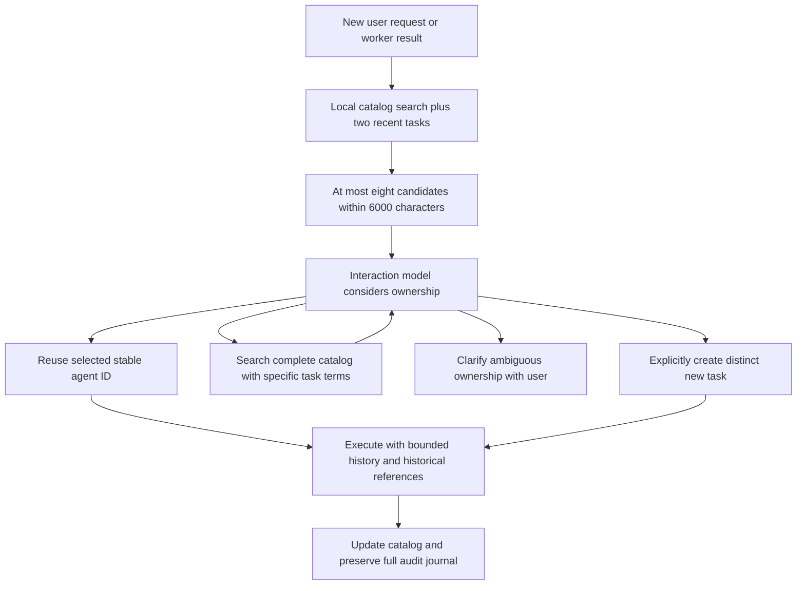

# Agent overload: preserve ownership with bounded discovery

The objective is to keep an assistant usable as its task contexts accumulate:
find the right existing owner, continue its work without mixing histories, and
bound the context sent to the models. Having many persisted agents is useful;
requiring the interaction model to inspect all of them on every turn is costly.

This implementation focuses on discovery and execution memory. It preserves
the existing interaction/execution split, asynchronous task dispatch, and
name-based trigger ownership.

## What goes wrong in the original implementation

The author's [explainer](https://www.shloked.com/writing/openpoke), under
“Execution Agent Overload,” describes the full roster entering every request
and suggests retrieval, recency, or archiving. The
[upstream prompt builder](https://github.com/shlokkhemani/openpoke/blob/main/server/agents/interaction_agent/agent.py)
and [roster](https://github.com/shlokkhemani/openpoke/blob/main/server/services/execution/roster.py)
show why retrieval needs more than searching names.

| Code path | Original behavior | Consequence |
| --- | --- | --- |
| `interaction_agent/agent.py` | Inject every agent name on every turn | Context grows with catalog size; names offer little task evidence |
| `execution/roster.py` | Persist names only | An agent named “Worker 017” cannot be found by its contact or project |
| `interaction_agent/tools.py` | Unknown name implicitly creates an agent | A spelling change or missed owner can create another task context |
| `execution_agent/agent.py` | Load the complete execution journal | Reusing an agent makes its prompt grow indefinitely |
| `record_tool_execution()` | Cut arguments at 200 and results at 500 characters | Draft/thread references can be lost even though old history is retained |
| `execution/log_store.py` | Use punctuation-normalized filename slugs | Different exact names can share a journal |
| `execution/roster.py` | Use Unix `fcntl`; open with `w` before locking | Windows import failure and unsafe roster update ordering |

These can reinforce each other: a missed owner leads to a new agent, making
future selection harder. A reused owner can still fail if its operational
references were truncated. The solution must address discovery and continuity
together.

## Implemented flow



### Persistent cards and indexed retrieval

`server/services/execution/roster.py` stores cards in SQLite:

- A stable routing UUID and the unchanged exact agent name.
- Original purpose, latest request, latest result, and activity time.
- Bounded snippets: 500, 500, and 1000 characters for those three text fields.

SQLite FTS5 indexes normalized task text. Search gives exact names priority,
then ranks lexical matches with BM25, weighting names and original purpose.
Chinese character/bigram terms are indexed as well. Search terms are quoted;
SQL values are bound parameters. A slower bounded LIKE fallback is available
when SQLite lacks FTS5.

This adds no embedding service, model call, credentials, or backend dependency.
It gives an inexpensive, reproducible baseline for a small local assistant.
It does **not** provide semantic matching between unrelated words; an embedding
retriever could later supplement it using the same candidate interface.

The shared `ExecutionBatchManager.execute_agent()` path records incoming tasks
and results. Scheduled requests therefore update the catalog too, rather than
only requests dispatched by the interaction tool.

### Bounded candidates, with a way to search again

`server/services/execution/routing.py` selects up to six relevant cards plus
two recent cards, deduplicates, and fills remaining slots when these overlap.
Recent cards help a follow-up such as “send it”; they do not prove which task
the user means. All selected cards receive a share of the rendering budget so
long earlier cards cannot evict the reserved recent tasks. The normal section
is capped at eight cards and 6000 characters, including XML escaping and tags.

The prompt explicitly labels this as an incomplete shortlist. `search_agents`
queries the entire catalog, so old tasks remain discoverable without keeping
their names in every request. Tool results also have bounded fields/counts.
The model should try task-specific or alternative terms if retrieval misses.

Search only supplies evidence. It never dispatches a task or automatically
chooses the top match. Alice's budget and Alice's lunch can have separate
owners; when a follow-up fits both, the prompt instructs the model to clarify.

### Explicit reuse versus creation

`send_message_to_agent` accepts a stable `agent_id` for reuse and keeps exact
name reuse for compatibility. A shortened display name never replaces the
canonical name used by execution history or triggers.

An unknown name defaults to `selection_required`, including candidate
suggestions. No work starts and no new card is created. A genuinely separate
task needs `create_new=true`; requesting creation with an already-owned name
is rejected. Unknown IDs are rejected rather than falling back to creation.

Searching before explicit creation and resolving ambiguous language remain
model policies, not formal proofs. The implementation prevents *implicit*
creation, not every possible deliberate duplicate. There is no fuzzy
automatic redirection of email sends.

### Bounded execution history and durable references

`ExecutionAgent` now defaults to a 12000-character history budget. The log store
streams records, keeps recent whole entries within the escaped character
budget, and retains up to twelve historical draft/thread/message identifiers
within a smaller reference budget. The prompt warns that older or oversized
entries may be absent. Identifiers are historical references, not current task
state, proof of approval, or permission to send.

The journal keeps full tool arguments and results. New records use explicit
JSON string encoding so literal escapes and newlines round-trip correctly;
the old format remains readable. New filenames use deterministic UUID5 keys
derived from the exact name, in `execution_agents/identities/`. Punctuation
variants therefore have separate new journals. Routing UUIDs live in the
catalog; these filename keys are a separate compatibility mechanism, and agent
renaming is not supported.

This bounds persisted history entering the prompt, not all context in a live
tool loop or disk growth. A very large current tool result can still enlarge
that loop. Reading history still scans the journal; a materialized reference
index and a tail offset would be a later optimization.

## Existing installations

On first use, the catalog imports `roster.json` into its `.sqlite3` sibling and
streams each legacy agent's journal once to backfill purpose/latest task/result.
This lets a dormant opaque name be found by an email address from its old
request. Originals stay untouched, and a transactional migration marker
prevents rescans and prevents cleared agents from reappearing from the backup.
Invalid legacy JSON is retained and can be repaired/retried on a later process
initialization.

New writes use identity-specific journals; reads can still include the legacy
slug journal. If two old names already shared one slug, their history cannot
be reliably disentangled. Prompts disclose that legacy ownership may be
ambiguous. Imported activity times initially reflect migration order/time,
not reconstructed historical activity. Existing trigger names keep working.

No automatic expiry/archive is implemented: there is not yet a reliable
structured model of pending approvals and active work. Hiding dormant cards
from the default shortlist while keeping them searchable avoids discarding
task owners prematurely.

## Tests and evaluation

From an environment with `server/requirements.txt` installed:

```powershell
python -m unittest discover -s tests -v
python -m evals.agent_overload --sizes 100 1000 10000 --output evals/results.json
```

The tests use temporary catalogs/journals and mock remote execution. No API
key or connected Gmail account is required. They cover migration, persistence,
concurrent catalog mutations, old-agent discovery, same-person alternatives,
stable-ID dispatch, explicit creation, escaping and character limits, durable
identifiers, and journal isolation. A scripted email follow-up traverses the
real dispatch/batch/execution loop and verifies that only the original lunch
draft ID reaches the mocked send tool, even after old history is omitted.
This tests orchestration; its scripted model does not establish natural
language routing accuracy.

The scale evaluator adds 100, 1000, or 10000 newer distractors to opaque-name
agents. Its fixed cases include contact-only evidence, cold tasks, two Alice
workstreams, a thread reference, two independent tasks, Chinese, scheduled
work, and unrelated new work. It checks Recall@5 and recall in the **actually
rendered** candidates, not just the list returned by retrieval. “Send it” has
two legitimate recent draft owners; the evaluator checks both remain visible
instead of inventing a single correct routing label.

The baseline reproduces the original complete roster of names to compare
context size. Results are saved in [`evals/results.json`](../evals/results.json).
The recorded run used CPython 3.13.7 and SQLite 3.50.4 on Windows 11:

| Distractors | Original roster characters | Maximum candidate characters | Recall@5 / rendered recall | Warm search p95 |
| ---: | ---: | ---: | ---: | ---: |
| 100 | 4449 | 3193 | 1.0 / 1.0 | 0.734 ms |
| 1000 | 42249 | 3194 | 1.0 / 1.0 | 1.411 ms |
| 10000 | 420249 | 3195 | 1.0 / 1.0 | 9.739 ms |

Recall above covers nine positive lexical relevance labels per scale. The
10000-distractor candidate section uses 99.24% fewer characters than the old
roster. Retrieval latency is measured locally, separately from catalog creation
and LLM latency. A separately reported paraphrase diagnostic returns no match
(recall 0.0), documenting the lexical retriever's failure on disjoint wording;
it is excluded from the positive lexical-recall gate.

Character reduction is not a measured token reduction, monetary saving, or
end-to-end speedup. The small synthetic suite does not establish production
routing accuracy. To evaluate those, run the same multi-turn scenarios against
the old and new implementation using a fixed real model, record chosen owner
and actual mock-mailbox state, and compare clarification, duplicate creation,
incorrect-thread actions, actual token usage, and wall-clock completion time.

## Remaining overload risks and scope

- Retrieval indexes only bounded original/latest task and latest result.
  Intermediate entities can age out, and unrelated wording can miss a match.
  Relevant older history is not semantically retrieved into execution prompts.
- Two recent cards can be displaced by unrelated foreground/background work;
  durable per-conversation task references would improve long follow-ups.
- The batch manager still has one active aggregate and no global concurrency
  limit or per-agent execution queue. Overlapping user turns can share a batch,
  and simultaneous work for the same owner can race. These are execution
  scheduling problems, distinct from catalog discovery.
- Email approval remains enforced by prompts, not an action-bound tool guard.
  A tool returning an error dictionary without raising can still be treated as
  successful by the pre-existing runtime wrapper. Neither issue is fixed here.
- Background notification filtering, total model-call budgets, tool schemas,
  current tool result sizes, and the interaction conversation's existing
  summarization scheme remain separate cost/attention controls.
- Catalog transactions support concurrent SQLite connections, but journal
  locks are process-local. The original application remains a single-user
  local prototype; this does not add account or tenant isolation.

The defensible claim is bounded, recoverable agent discovery with better
history continuity and measurable offline behavior. The accompanying tests
and report separate that claim from unmeasured model behavior and the wider
scheduling, approval, and cost problems.
